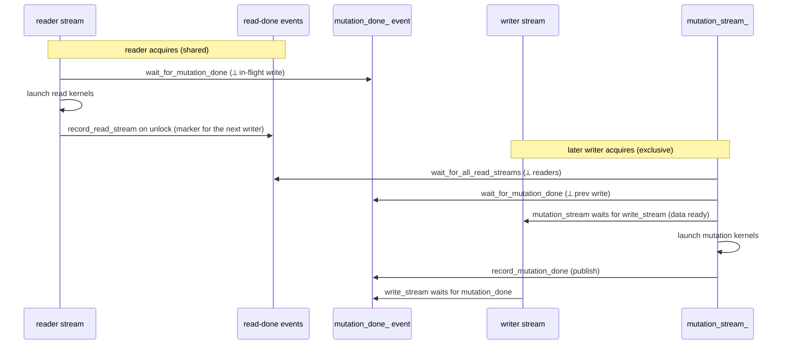
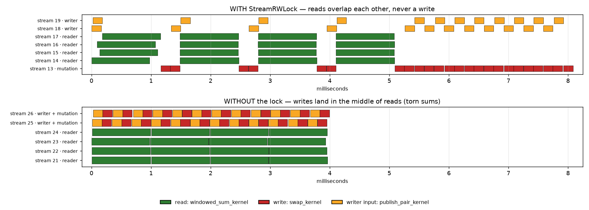
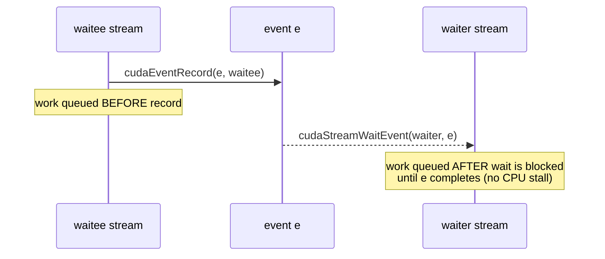

# Stream-based read-write lock

This document explains `StreamRWLock` in [`stream_rwlock.cuh`](./stream_rwlock.cuh): why it
exists, the design alternatives that were rejected, and how the implementation
works line by line. If you are not comfortable with CUDA streams and events,
read the [appendix](#appendix-cuda-stream--event-primitives) first — the rest of
the document assumes those primitives.

# Problem

Every doc with features is built into an ANN index. Its filtering features are
built into a bloom index and a feature index. To support ads targeting/pacing,
we need to **update the index for a doc in real time**, concurrently with
queries that are reading it.

The difficulty is that a single logical update to one doc touches **multiple
locations across several sub-indices** (bloom filter, feature index, ANN
structures). If a reader observes the index *while* an update is only half
applied, it sees an inconsistent state and can return wrong results.

We therefore need a **consistent view** of the ANN index: a reader must see
either the state *before* an update or the state *after* it, never a partial
in-between state. This is essentially a transactional "all or nothing"
requirement, but it has to hold on the GPU where reads and writes are
asynchronous kernel launches on CUDA streams.

# Design options

At a high level this is the classic transaction requirement (see nothing or see
everything). A few ways to get there:

1. **Full transactions (atomic / MVCC).** The most general solution, but hard to
   implement efficiently on the GPU. Maintaining multiple versions or atomic
   commit protocols across many device-side data structures is expensive and
   complex.
2. **A data-level read-write lock**, like a CPU rwlock guarding the index
   memory. Theoretically doable, but there is no efficient GPU primitive for
   fine-grained locking of device data on the hot path.
3. **A stream-level read-write lock on the *resource*.** Instead of locking
   data, we serialize *work* at stream granularity using two roles — a **reader
   stream** and a **writer stream** — and use CUDA events to enforce the
   read/write ordering on the device. This is cheap (no device-side locking, no
   CPU stalls) and maps naturally onto how kernels are already launched.

`StreamRWLock` implements option 3.

# The core idea

CUDA gives us two building blocks (details in the
[appendix](#appendix-cuda-stream--event-primitives)):

1. **Stream** — an ordered queue of GPU work. Operations on the *same* stream run
   in order; operations on *different* streams may overlap and have **no**
   guaranteed ordering.
2. **Event** — a lightweight marker recorded into a stream. Another stream can
   *asynchronously* wait on it via `cudaStreamWaitEvent`, which inserts a
   device-side dependency **without blocking the CPU**.

The trick "the waiter stream waits for the waitee stream" is: record an event on
the waitee, then have the waiter wait on that event. Using events as bridges, we
can build a small computation
graph across streams that enforces reader/writer semantics — all asynchronously,
without ever stalling the host on the hot path.

We want the standard rwlock invariant expressed in stream terms:

- readers may run concurrently with **other readers**;
- a writer is **exclusive** with all readers and with other writers.

## Reader stream

A reader stream launches kernels that only *read* the index. Readers must be
**concurrent with each other** but **mutually exclusive with any writer**. We
achieve this by having each reader stream wait on a single "write done" event
before it launches its read kernels: if a write is in flight, the reader's
kernels are queued behind it on the device; if no write is in flight, the wait is
a no-op and readers proceed (and overlap) freely.

## Writer stream

A writer stream launches mutation kernels. A writer must be **exclusive with
both readers and other writers**. We achieve this by making the writer wait for:

1. **every read since the previous write** to finish. A reader leaves a "read
   done" event behind on its own stream when it releases the lock; the lock
   keeps the latest such event per reader stream (`read_streams_`) and the
   writer waits on all of them.
2. **the previous write** to finish — by waiting on the same "write done" event
   the readers use.

Only after both waits are queued does the writer launch its mutation kernels.

Note what the writer does *not* consult: who is currently holding a read lock. A
read-done event captures everything queued on that stream at the moment it is
recorded, so the reader may drop its `RLock` immediately after launching and the
writer still waits for those kernels. Tracking live readers instead would let a
writer that arrives just after the last reader let go mutate the buffer while
that reader's kernels were still running on the device.

# Data structures

```73:87:silvertorch/ops/csrc/stream_rwlock.cuh
private:
  // Serializes the host-side "set up sync + launch" critical section.
  std::mutex launch_mutex_;

  // read streams with their done events since the previous write.
  std::unordered_map<cudaStream_t, cudaEvent_t> read_streams_;

  // Pool of events for reuse.
  std::vector<cudaEvent_t> event_pool_;

  // Marks completion of the latest write; readers and the next writer wait on it.
  cudaEvent_t mutation_done_;

  // Private stream on which mutation kernels run.
  cudaStream_t mutation_stream_;
```

- `launch_mutex_` — a host-side mutex serializing the *set-up-and-launch*
  critical section (see [launch mutex](#the-launch-mutex-host-side-critical-section)).
  It guards every field below, so none of them need a lock of their own.
- `read_streams_` — reader stream → the read-done event recorded on it, for every
  stream that has read since the last write. A writer waits on the values and
  clears the map; the next read repopulates it.
- `event_pool_` — a free list of events the fences borrow and return, so the hot
  path does not create and destroy one per fence (see
  [the event pool](#the-event-pool)).
- `mutation_done_` — a single reusable event that marks "the latest write has
  finished". Readers and the next writer both wait on it. Created with
  `cudaEventDisableTiming` (ordering only, no timing overhead).
- `mutation_stream_` — a private, internal stream that actually runs the
  mutation kernels (see [mutation stream optimization](#optimization-a-dedicated-mutation-stream)).

The constructor creates `mutation_done_` and `mutation_stream_`; the destructor
destroys them, along with every event still held by `read_streams_` or
`event_pool_`.

# The `LockGuard` RAII wrapper

```28:38:silvertorch/ops/csrc/stream_rwlock.cuh
template <typename LockType> struct LockGuard {
  LockType &lock_;
  explicit LockGuard(LockType &lock) : lock_(lock) { lock_.lock(); }
  ~LockGuard() { lock_.unlock(); }

  LockGuard(const LockGuard &) = delete;
  LockGuard &operator=(const LockGuard &) = delete;

  // Convenience passthrough to the stream callers should launch on.
  cudaStream_t get_stream() { return lock_.get_stream(); }
};
```

`LockGuard` is a scoped guard: it calls `lock()` on construction and `unlock()`
on destruction, so the critical section is bounded by the enclosing C++ scope. It
also forwards `get_stream()` for convenience, so callers can get the stream they
should launch on straight from the guard. It holds the lock **by reference** and
is non-copyable, which keeps the promise of exactly one `lock()`/`unlock()` pair
per guard on the very object the caller passed in.

Both usage patterns follow the same shape:

```cpp
// Reader
RLock rlock = rwlock.get_rlock(stream);
LockGuard guard(rlock);
auto read_stream = guard.get_stream();      // == the caller's read stream
launch_reading_kernels_on(read_stream);
// guard goes out of scope -> unlock()

// Writer
WLock wlock = rwlock.get_wlock(stream);
LockGuard guard(wlock);
auto mutation_stream = guard.get_stream();  // == the private mutation stream
launch_writing_kernels_on(mutation_stream);
// guard goes out of scope -> unlock()
```

# Implementation walkthrough

## Read path

A read lock is just the `lock()`/`unlock()` pair driven by `LockGuard`; the
`RLock` itself owns no state beyond the two handles it was built with.

```161:174:silvertorch/ops/csrc/stream_rwlock.cuh
  struct RLock {
    StreamRWLock *rwlock_;
    cudaStream_t read_stream_;

    RLock(StreamRWLock *rwlock, cudaStream_t read_stream)
        : rwlock_(rwlock), read_stream_(read_stream) {}
    ~RLock() = default;

    void lock() { rwlock_->r_lock(read_stream_); }

    void unlock() { rwlock_->r_unlock(read_stream_); }

    cudaStream_t get_stream() { return read_stream_; }
  };
```

`RLock` is a thin handle: it only holds the back-pointer `rwlock_` and the reader
stream, and delegates all locking logic to `StreamRWLock::r_lock` /
`StreamRWLock::r_unlock` (see [the reader logic](#the-reader-logic) below).

Step by step:

1. **`lock()`.** Calls `r_lock(read_stream_)`, which takes `launch_mutex_`
   (serializing the host-side launch sequence), then calls
   `wait_for_mutation_done(read_stream_)`, which does
   `cudaStreamWaitEvent(read_stream_, mutation_done_)`. This makes the
   reader's stream wait for the last recorded write to complete on the device —
   but does **not** stall the CPU. If no write ever recorded the event, the wait
   is effectively a no-op and the reader proceeds immediately, overlapping with
   other readers.
2. **Launch kernels.** With the guard held, the caller launches its read kernels
   on `get_stream()`. These kernels are now correctly ordered *after* any
   in-flight write.
3. **`unlock()`.** Calls `r_unlock(read_stream_)`, which records a read-done
   event on the read stream (`record_read_stream`) and then releases
   `launch_mutex_`. The event is the reader's whole contribution to the lock's
   state: it marks "everything this section queued" for the next writer to wait
   on.
4. **Destruction.** Nothing happens — the destructor is defaulted. The read
   *lock* only ever guarded the *launch*: the kernels keep running
   asynchronously, the recorded event keeps the next writer behind them, and the
   caller can let the `RLock` go as soon as it has launched.

## Write path

```176:190:silvertorch/ops/csrc/stream_rwlock.cuh
  struct WLock {
    StreamRWLock *rwlock_;
    // Caller's stream, where the input data for the update comes from.
    cudaStream_t write_stream_;

    WLock(StreamRWLock *rwlock, cudaStream_t write_stream)
        : rwlock_(rwlock), write_stream_(write_stream) {}
    ~WLock() = default;

    void lock() { rwlock_->w_lock(write_stream_); }

    void unlock() { rwlock_->w_unlock(write_stream_); }

    cudaStream_t get_stream() { return rwlock_->mutation_stream_; }
  };
```

Like `RLock`, `WLock` is a thin handle: `lock()` / `unlock()` delegate to
`StreamRWLock::w_lock` / `StreamRWLock::w_unlock` (see
[the writer logic](#the-writer-logic) below).

`WLock` distinguishes two streams:

- `write_stream_` — the caller's stream, where the *input data* for the update
  lives (e.g. the new feature values were copied in here).
- `mutation_stream_` — the lock's private stream, where the *mutation kernels*
  actually run. `get_stream()` returns this one.

`w_lock()` builds the exclusivity fence, in order:

1. **Take `launch_mutex_`.** Serialize the host-side launch sequence.
2. **`wait_for_all_read_streams()`.** Have the private `mutation_stream_` wait on
   every read-done event in `read_streams_`, then clear the map (the events go
   back to the pool). This makes the mutation kernels wait for every read since
   the previous write, whether it has finished or is still running
   (writer ⟂ readers). Note the fence is placed on `mutation_stream_`, **not** on
   the caller's `write_stream_`, so the input-data copy on `write_stream_` can
   still overlap with ongoing reads. See the helper below.
3. **`wait_for_mutation_done(mutation_stream_)`.** Have `mutation_stream_` wait
   on `mutation_done_`, so this write is ordered after the previous write
   (writer ⟂ previous writer).
4. **`wait_for_stream(mutation_stream_, write_stream_)`.** Make the private
   `mutation_stream_` wait for `write_stream_`, so the mutation kernels only
   start after the input data on `write_stream_` is ready. From here,
   mutation kernels can be launched on `mutation_stream_`.

`w_unlock()` publishes the write and hands results back:

1. **`record_mutation_done()`.** Record `mutation_done_` on `mutation_stream_`. This is
   the marker future readers and the next writer wait on — it becomes "complete"
   once this write's kernels finish.
2. **`wait_for_mutation_done(write_stream_)`.** Make the caller's `write_stream_`
   wait on the event just recorded, so that anything the caller queues afterward
   on its own stream observes the completed mutation.
3. **Release `launch_mutex_`.**

### The reader logic

The reader-side sequencing lives in two `StreamRWLock` methods that `RLock`
forwards to. Keeping the logic here (rather than inline in `RLock`) means the
handle stays a trivial forwarding shim and the actual synchronization lives next
to the state and helpers it touches.

```196:209:silvertorch/ops/csrc/stream_rwlock.cuh
  // Reader lock/unlock logic, executed on behalf of RLock.
  void r_lock(cudaStream_t read_stream) {
    // Hold the launch mutex to prevent concurrent kernel launches.
    this->launch_mutex_.lock();
    // Wait for any ongoing mutation to finish asynchronously.
    this->wait_for_mutation_done(read_stream);
    // From now on, the read stream is free to launch reading kernels.
  }

  void r_unlock(cudaStream_t read_stream) {
    // Leave a device-side marker for the next writer to wait on.
    this->record_read_stream(read_stream);
    this->launch_mutex_.unlock();
  }
```

### The writer logic

Symmetrically, `WLock` forwards to `w_lock` / `w_unlock`, which hold the full
write fence and publish sequence described above.

```211:236:silvertorch/ops/csrc/stream_rwlock.cuh
  // Writer lock/unlock logic, executed on behalf of WLock.
  void w_lock(cudaStream_t write_stream) {
    // Hold the launch mutex to prevent concurrent kernel launches.
    this->launch_mutex_.lock();

    // Mutation stream waits for all read streams since the previous write to finish asynchronously.
    this->wait_for_all_read_streams();

    // Mutation stream waits for the previous mutation to finish asynchronously.
    this->wait_for_mutation_done(this->mutation_stream_);

    // Mutation stream waits for the write stream so the input data is ready.
    this->wait_for_stream(this->mutation_stream_, write_stream);

    // From now on, the mutation stream is free to launch mutation kernels.
  }

  void w_unlock(cudaStream_t write_stream) {
    // Record the write-done event on the mutation stream.
    this->record_mutation_done();

    // Write stream waits for the mutation done so the caller sees the result.
    this->wait_for_mutation_done(write_stream);

    this->launch_mutex_.unlock();
  }
```

### The helpers

In the header every CUDA call here is wrapped in a macro that aborts with the
failing call, file and line — none of them can fail on a healthy device, and
silently dropping a fence would surface as a data race somewhere else entirely.
The listings below drop the wrapper to keep the synchronization readable.

```cpp
  // Mutation stream waits for every read stream since the previous write.
  void wait_for_all_read_streams() {
    for (const auto &[read_stream, done_event] : this->read_streams_) {
      cudaStreamWaitEvent(this->mutation_stream_, done_event);
      this->release_event(done_event);
    }
    this->read_streams_.clear();
  }

  // Record read-done on the read stream.
  void record_read_stream(cudaStream_t read_stream) {
    auto it = this->read_streams_.find(read_stream);
    cudaEvent_t done_event = (it != this->read_streams_.end()) ? it->second : this->acquire_event();
    cudaEventRecord(done_event, read_stream);
    this->read_streams_[read_stream] = done_event;
  }

  // The waiter stream waits for the waitee stream to finish.
  void wait_for_stream(cudaStream_t waiter, cudaStream_t waitee) {
    if (waiter != waitee) {
      // Place an event on the waitee and let the waiter wait for it asynchronously.
      cudaEvent_t event = this->acquire_event();
      cudaEventRecord(event, waitee);
      cudaStreamWaitEvent(waiter, event);
      this->release_event(event);
    }
  }
```

- `record_read_stream` is the reader half, called from `r_unlock`. It records a
  read-done event on the reader's own stream, reusing that stream's existing
  event if it still has one: re-recording moves the marker forward to cover the
  read just launched, and since a stream runs in order, the newest marker implies
  every earlier one on the same stream.
- `wait_for_all_read_streams` is the writer half. It walks the map, has
  `mutation_stream_` wait on each read-done event, returns the events to the pool
  and empties the map — the dependencies are now baked into `mutation_stream_`,
  so nothing is lost by forgetting them.
- `wait_for_stream(A, B)` is the generic "A waits for B" bridge, skipping the work
  when `A == B` (a stream is always ordered with itself).

All three take their event from the [event pool](#the-event-pool) rather than
creating one, which is why none of them is `static`.

The asymmetry — the reader records, the writer waits — is what makes the
dependency outlive the reader. An event recorded at `r_unlock` time already
captures the read kernels, so it stays valid after the `RLock` is gone. The
alternative, having the writer record events on the streams it finds registered,
only works while those readers are still holding the lock.

### The event pool

Every fence needs a throwaway event, and creating and destroying one per fence is
pure overhead on a path that is supposed to be cheap. `event_pool_` is a free
list of already-created events:

```cpp
  cudaEvent_t acquire_event() {
    if (!this->event_pool_.empty()) {
      cudaEvent_t event = this->event_pool_.back();
      this->event_pool_.pop_back();
      return event;
    }
    cudaEvent_t event;
    cudaEventCreateWithFlags(&event, cudaEventDisableTiming);
    return event;
  }

  void release_event(cudaEvent_t event) {
    this->event_pool_.push_back(event);
  }
```

`acquire_event` hands back a pooled event or creates one on a miss;
`release_event` returns it. The pool only ever grows to the high-water mark of
events out on loan at once — one per reader stream that has read since the last
write, plus one for a `wait_for_stream` bridge — and the destructor destroys
whatever it holds.

Recycling an event this soon is safe because `cudaStreamWaitEvent` **captures the
event's state at the time of the call**: the dependency it inserted into the
waiter stream is fixed once the call returns, and re-recording the same event
afterwards does not disturb it. So an event is reusable as soon as every
`cudaStreamWaitEvent` naming it has been issued — which is exactly where
`release_event` is called, not when the waited-for work completes.

Read-done events are the one exception to "borrow, use, return immediately":
`record_read_stream` keeps its event in `read_streams_` until a writer has waited
on it, because it has to survive until *someone* waits. That is the only state in
the lock with a lifetime longer than one critical section.

Note the pool itself is plain, unsynchronized `std::vector` access. That is safe
only because every caller runs inside the
[launch mutex](#the-launch-mutex-host-side-critical-section): the users are
reached from `r_unlock`, `w_lock` and `w_unlock`, which all hold it. Any future
caller outside that critical section would need its own guard.

The remaining one-liners just wrap the raw CUDA calls:

```cpp
  void record_mutation_done() {
    cudaEventRecord(this->mutation_done_, this->mutation_stream_);
  }

  void wait_for_mutation_done(cudaStream_t stream) {
    cudaStreamWaitEvent(stream, this->mutation_done_);
  }
```

# The launch mutex (host-side critical section)

The events above enforce ordering on the **device**. But the act of *queueing*
those events from the CPU is itself a critical section: `cudaEventRecord` and
`cudaStreamWaitEvent` are ordered relative to whatever is *already enqueued* on a
stream at the time of the call. If two host threads interleaved their record /
wait calls, the recorded dependencies would capture the wrong "before/after"
boundaries and the resulting cross-stream graph would be nonsense.

`launch_mutex_` is a plain `std::mutex` that serializes the entire
"set up the sync + launch kernels" block. Both `r_lock()` and `w_lock()` (invoked
via `RLock::lock()` / `WLock::lock()`) take it first and hold it (via `LockGuard`)
until after the caller has launched its kernels and `unlock()` runs. This
guarantees that each
reader/writer atomically (from the host's point of view) builds its fence and
enqueues its kernels before anyone else starts building theirs.

Because everything inside is asynchronous enqueue-and-return, this host lock is
held only briefly — long enough to queue work, not to run it.

# Optimization: a dedicated mutation stream

Naively, a writer would run its mutation kernels directly on
`write_stream_`. But `write_stream_` is typically where the caller first
*copies the new data in* (host→device). Running the mutation kernels on that
same stream forces the copy and the mutation to be strictly serial, and ties
up the caller's stream for the whole mutation.

Instead, `StreamRWLock` owns a private `mutation_stream_` and runs the
mutation kernels there:

- the data copy can proceed on `write_stream_` while `mutation_stream_` is being
  set up;
- the reader-exclusion fence is placed on `mutation_stream_`
  (`wait_for_all_read_streams`, step 2 of `w_lock()`), **not** on `write_stream_`,
  so the input-data copy can overlap with in-flight reads;
- `mutation_stream_` waits for `write_stream_` (step 4 of `w_lock()`), so it still
  starts only after the input is ready;
- when done, `write_stream_` waits for `mutation_stream_` (step 2 of `w_unlock()`),
  so the caller transparently sees the finished result.

This decouples the caller's stream from the internal mutation work and allows
overlap, at the cost of a couple of extra event syncs.

# Putting it together



Invariants maintained:

- **reader ∥ reader** — readers only wait on `mutation_done_`, never on each other.
- **writer ⟂ reader** — a writer waits for every read since the previous write,
  running or not; a later reader waits on `mutation_done_`.
- **writer ⟂ writer** — each writer waits on `mutation_done_` and republishes it.

# End-to-end test: a sum that must not tear

[`tests/test_stream_rwlock_e2e.py`](./tests/test_stream_rwlock_e2e.py) exercises
the whole lock as one workload, from Python, and checks the *consistent view*
property the lock exists for. `StreamRWLock` is header-only, so the test compiles
a small harness against `stream_rwlock.cuh` with
`torch.utils.cpp_extension.load_inline` — no `torch.ops.st.*` op is involved.

The unit-style scenarios in
[`tests/test_stream_rwlock.py`](./tests/test_stream_rwlock.py) each isolate one
fence; this test instead runs everything at once and asks a single question of
the result: *did any reader ever see a half-applied state?*

## The workload

The shared resource is a device buffer of `n = 1024` distinct floats (a
permutation of `1..n`, so every value is unique and every sum is exact in
`double`).

| Role | Kernel | What it does |
| --- | --- | --- |
| reader | `windowed_sum_kernel` | sums the buffer, one element at a time, spinning between elements |
| writer (input) | `publish_pair_kernel` | writes the index pair for the next swap, on the **writer's own stream** |
| writer (mutation) | `swap_kernel` | swaps the two elements, spinning between the two stores |

The trick is that **a swap preserves the sum**: each mutation leaves the buffer a
permutation of itself. So a reader with a consistent view — the buffer entirely
before or entirely after each swap — *must* return the initial sum. A reader that
straddles a mutation does not, in either of two ways:

1. it sees the swap **half-applied**: `buf[i]` already holds the new value while
   `buf[j]` still holds the old one, so one value is counted twice and the other
   not at all;
2. it sees the swap **fully applied, but only partly**: it read the low index
   before the swap and the high index after it.

Both come out as a sum that differs from the invariant, which turns "was this
view consistent?" into one exact float comparison — no sampling, no tolerance.

Two details make the read a *window* rather than an instant, so that a
concurrent mutation is actually observable instead of being a rare coincidence:

- the sum kernel spins `READ_SPIN` cycles after every element (a read spans
  ~1 ms) and loads through `volatile`, so the loads are not hoisted out of the
  loop;
- each writer draws its two indices from **opposite halves** of the buffer, so
  the indices are far apart and a reader scanning in index order is likely to sit
  between them when a swap lands.

Neither affects correctness under the lock; they only make a *missing* fence show
up reliably.

## The threads

Four readers and two writers, each on its own host thread with its own CUDA
stream, all released from a barrier so they genuinely contend. Every reader does
4 rounds, every writer 12 (enough that the writers stay busy for as long as the
readers do, leaving no read uncontended). Between them they drive all four
fences:

| Fence | How the test would notice it missing |
| --- | --- |
| `r_lock` waits for the in-flight mutation | a reader would sum a half-applied swap |
| `w_lock` waits for the read-done events | a swap would land inside a read window |
| `w_lock` waits for the caller's stream | `swap_kernel` would read a stale or half-written index pair |
| `w_unlock` waits for the mutation | the writer's own `cudaStreamSynchronize` would return before its swap finished, and the next round would overwrite the pair slot still being read |

The readers deliberately let go early: the `LockGuard` and the `RLock` are both
destroyed as soon as the sum kernel is *launched*, and only then does the thread
call `cudaStreamSynchronize`. So for most of every read there is no reader-side
object left, the read kernel is still running, and the thread that would have
been holding it is parked in the synchronize — leaving a writer free to take the
lock in exactly that window. The only thing standing between it and a torn sum is
the read-done event `r_unlock` recorded, which is the point: a lock that waited on
*live* readers instead would see nobody here and mutate the buffer mid-read.

## The negative control

The same harness takes a `use_lock` flag. With `use_lock=false` the same six
threads launch straight onto their own streams, with no cross-stream ordering at
all, and the mutations run on the writer's own stream instead of
`mutation_stream_`. That run is expected to tear, and does: on an L40S it
corrupts 8–16 of the 16 reads on every attempt, while the locked run has never
produced a single torn read. Without this control the test would pass just as
happily if the lock were a no-op.

The locked run additionally asserts that the final buffer is still a permutation
of the input — that is writer ⟂ writer: no swap was lost or left half-applied.
Two unsynchronized writers whose swaps happen to share an index would interleave
their four stores and duplicate or drop a value, breaking the multiset for good;
with indices drawn from opposite halves that collision is rare, so what the
unlocked run reliably shows is the torn reads, not a corrupted buffer.

## The timeline

The last test runs both configurations under `torch.profiler` and exports Chrome
traces, so the two invariants can also be *seen*, and asserts both from the trace
rather than only inferring them from the sums:

- **writer ⟂ reader** — no `windowed_sum_kernel` overlaps a `swap_kernel`: 0
  overlapping pairs out of the 16 × 24 = 384 possible ones;
- **reader ∥ reader** — sum kernels on *different* streams do overlap: 24 pairs,
  which is all 6 pairs of the 4 readers in each of the 4 rounds, overlapping by
  ~0.98 ms of their ~0.98 ms duration — i.e. fully concurrent, not merely
  touching at the edges.

The second assertion matters: without it, a lock that simply serialized
everything would pass the first one.

A trace from each configuration is checked in under
[`tests/traces/`](./tests/traces) for reference, together with the rendering of
them shown below, so the timeline can be looked at without a GPU (the numbers
above are from `traces/stream_rwlock_locked.json`; they shift a little from run to
run). To regenerate the traces:

```bash
# these tests are marked `slow`, hence -S; -s prints the trace paths
STREAM_RWLOCK_TRACE_DIR=silvertorch/ops/csrc/tests/traces \
    pytest silvertorch/ops/csrc/tests/test_stream_rwlock_e2e.py -S -s -k profile
```

Both checked-in traces, drawn with one row per CUDA stream and time running to
the right:



Four things are worth noticing in the locked run (top):

- the reader rows are **stacked**: all four sum kernels start together and run
  side by side, four to a band, so readers really are shared and not serialized.
  They stay in phase because the round's `r_lock` waits on `mutation_done_` — the
  swap sitting in the gap releases all four readers at once;
- every `swap_kernel` sits on a *single* row — the lock's private
  `mutation_stream_`, no matter which writer thread issued it — and always in a
  **gap** between reader bands;
- the writers have 12 rounds each against the readers' 4, so once the last read
  retires (~5.1 ms) the leftover swaps have nothing to wait for and drain
  back-to-back;
- the writers' `publish_pair_kernel` bars **do** overlap the reader bands. That
  is the [dedicated mutation stream optimization](#optimization-a-dedicated-mutation-stream)
  working as intended: the reader-exclusion fence is on `mutation_stream_`, not on
  the caller's stream, so preparing a writer's input data is free to run
  concurrently with in-flight reads. Only the mutation itself is exclusive.

In the unlocked run (bottom) all of that collapses: the mutation bars move on top
of the reader bands (111 of the 384 pairs overlap) and the writers no longer share
a mutation stream — 12 pairs of swaps overlap each other too — which is exactly
the tearing the sums report.

### Getting this view yourself

The picture above comes from
[`traces/render_timeline.py`](./tests/traces/render_timeline.py), which keeps only
the GPU kernel slices and drops everything else in the trace:

```bash
python silvertorch/ops/csrc/tests/traces/render_timeline.py \
    silvertorch/ops/csrc/tests/traces/stream_rwlock_locked.json \
    silvertorch/ops/csrc/tests/traces/stream_rwlock_unlocked.json \
    -o silvertorch/ops/csrc/tests/traces/stream_rwlock_timeline.png
```

To get the same view interactively, load a trace into
[ui.perfetto.dev](https://ui.perfetto.dev) — but note that a PyTorch trace
contains **two** process groups, and the pattern is only in one of them:

- **`python` / `GPU 0`** — one track per CUDA stream (`stream 34`, `stream 35`,
  ...), holding the kernels as they actually *ran*. This is the one to look at.
- **`python` / `CPU`** — one track per host thread, holding `cudaLaunchKernel`
  and friends: when each launch was *queued*. Launches are asynchronous, so they
  bunch up at the front and show no exclusivity whatsoever. Nothing is wrong when
  those rows look like a free-for-all — that is the whole point of the lock: it
  fences on the device without stalling the host.

In the `GPU 0` group the stream tracks map onto the roles as follows (stream
numbers are whatever CUDA handed out on that run, so expect different ones):

| Track | Slices | Role |
| --- | --- | --- |
| `stream 13` | 24 × `swap_kernel` | the lock's private `mutation_stream_` — *every* writer's mutation |
| `stream 14`–`17` | 4 × `windowed_sum_kernel` each | the four reader threads |
| `stream 18`–`19` | 12 × `publish_pair_kernel` each | the two writer threads' own streams |

Two things make the slices hard to read at first: the harness kernels live in an
anonymous namespace, so every slice name starts with the same
`(anonymous namespace)::` prefix and gets truncated in narrow bars, and the
default zoom covers the profiler's whole session rather than the ~8 ms of
workload. Zoom into the region where the stream tracks have slices (`W`/`S` to
zoom, `A`/`D` to pan) and identify the tracks by their slice *counts* from the
table above.

---

# Appendix: CUDA stream & event primitives

This appendix is a quick reference for the underlying CUDA building blocks used
throughout this document. If you already know CUDA streams and events, skip it.

### A.1 What a stream is

A **CUDA stream** is an ordered queue of GPU work (kernels and memory copies).
The rules are simple:

- Operations issued to the **same** stream execute **in order**, one after
  another.
- Operations in **different** streams may execute **concurrently**, in any
  relative order, and can overlap on the hardware.
- The host call that *enqueues* work (`cudaMemcpyAsync`, a kernel launch, ...)
  returns almost immediately; the work runs **asynchronously** on the GPU.

That is the whole reason this project uses multiple streams: reads and writes go
into different queues so they can overlap, and ordering between them is *not*
guaranteed unless we add it explicitly.

```cpp
cudaStream_t s;
cudaStreamCreate(&s);          // create
myKernel<<<grid, block, 0, s>>>(...);   // enqueue kernel on s (async)
cudaMemcpyAsync(dst, src, n, cudaMemcpyDefault, s); // enqueue copy on s (async)
cudaStreamDestroy(s);          // destroy (after work is done)
```

> **The default stream (stream 0).** If you launch work without naming a stream,
> it goes to the "default" stream, which (in the legacy mode) synchronizes with
> everything. This project always passes explicit streams precisely to avoid that
> accidental global serialization.

### A.2 Waiting from the host: `cudaStreamSynchronize`

`cudaStreamSynchronize(s)` **blocks the calling CPU thread** until every
operation previously enqueued on `s` has finished. This is the coarse,
host-side "make it done now" tool.

```cpp
cudaMemcpyAsync(d, h, n, cudaMemcpyDefault, s);
cudaStreamSynchronize(s);   // CPU waits here; after this, d is guaranteed ready
```

Use it sparingly on the hot path: it stalls the CPU and kills overlap. Prefer
event-based ordering (below) when you only need *streams* to wait on each other,
not the CPU. This is exactly why `StreamRWLock` uses events, not
`cudaStreamSynchronize`, for its reader/writer fences.

### A.3 Events: `cudaEventRecord` + `cudaStreamWaitEvent`

A **CUDA event** is a lightweight marker you can drop into a stream and later
wait on. Two calls form the pair:

- **`cudaEventRecord(e, waitee)`** — enqueue a marker `e` into stream `waitee`.
  `e` becomes "complete" once all work enqueued on `waitee` *before* this call
  finishes.
- **`cudaStreamWaitEvent(waiter, e)`** — make stream `waiter` wait: all work
  enqueued on `waiter` *after* this call is delayed until `e` completes.

Crucially, `cudaStreamWaitEvent` does **not** block the CPU — it inserts a
*device-side* dependency. This is how you order one stream behind another
without stalling the host.

```cpp
// "everything queued on waitee before now must finish before waiter continues"
cudaEvent_t e;
cudaEventCreateWithFlags(&e, cudaEventDisableTiming); // no timing = cheaper
cudaEventRecord(e, waitee);
cudaStreamWaitEvent(waiter, e);
cudaEventDestroy(e);
```

That snippet is the `wait_for_stream` helper in `stream_rwlock.cuh`, except that
the real one borrows `e` from the [event pool](#the-event-pool) instead of
creating and destroying it:

```cpp
void wait_for_stream(cudaStream_t waiter, cudaStream_t waitee) {
  if (waiter != waitee) {
    cudaEvent_t e = this->acquire_event();
    cudaEventRecord(e, waitee);
    cudaStreamWaitEvent(waiter, e);
    this->release_event(e);
  }
}
```

Note that `e` goes back to the pool immediately, right after the wait is
*issued* — not after the waited-for work has finished. `cudaStreamWaitEvent`
captures the event's state at the point of the call, so the dependency survives
the event being recorded again later.

> **`cudaEventDisableTiming`.** Events can also be used to *measure* elapsed GPU
> time. When you only need ordering (as here), pass `cudaEventDisableTiming` so
> the driver skips the timing bookkeeping — slightly cheaper. Every event in
> `stream_rwlock.cuh` uses this flag.

A reusable event (created once, recorded/awaited many times) is exactly how
`mutation_done_` couples writers and readers — see
[the write path](#write-path).


